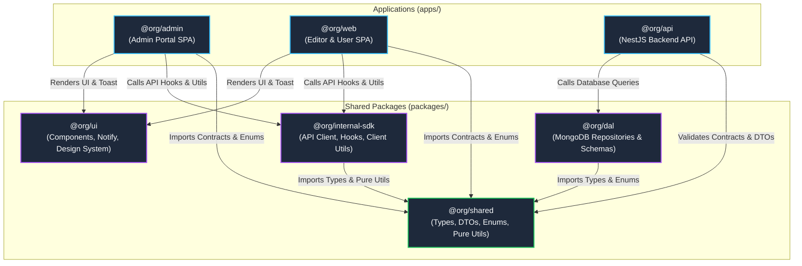

# Technical Blogging Platform — Full-Stack Monorepo (Nx, NestJS, Next.js, MongoDB)

Welcome to the **Technical Blogging Platform Monorepo**. This workspace is designed as an enterprise-grade, scalable foundation for a modern technical blogging platform built using **TypeScript**, **Next.js**, **NestJS 11**, **MongoDB (Mongoose)**, **Cloudflare R2**, **Tailwind CSS**, **Better Auth**, and **TanStack Query**.

---

## 🏗️ Architectural Blueprint

The monorepo enforces a **strict modular separation of concerns**. The workspace is divided into end-user **Applications (`apps/`)** and decoupled, reusable **Libraries (`packages/`)**:

```
tech-blogs/
├── apps/
│   ├── api/          (@org/api)          — Real-time backend API server (NestJS 11 + Fastify + Mongoose + R2)
│   ├── admin/        (@org/admin)        — Admin management portal SPA (React 19 + Vite + Tailwind CSS)
│   └── web/          (@org/web)          — Public technical blogging platform (Next.js)
└── packages/
    ├── shared/       (@org/shared)       — Universal types, DTO contracts, enums & pure utilities
    ├── dal/          (@org/dal)          — Data Access Layer for MongoDB (Mongoose Schemas, Repositories & Entities)
    ├── ui/           (@org/ui)           — Shared React UI component library, design system & notification toaster
    └── internal-sdk/ (@org/internal-sdk) — Frontend API client, TanStack Query hooks, Auth provider & client utilities
```

---

## 🔗 Unidirectional Dependency Flow

To maintain code cleanliness, modularity, and rapid build times, **strictly follow the unidirectional dependency rules**:



---

## 🧭 Where Should You Put Your Code?

When writing new features, components, or utilities, use this definitive decision matrix:

| What you are building                                                                                   | Where it belongs                        | Rule & Why                                                                                                                                                                                         |
| :------------------------------------------------------------------------------------------------------ | :-------------------------------------- | :------------------------------------------------------------------------------------------------------------------------------------------------------------------------------------------------- |
| **API Request / Response Types & DTO Contracts**                                                        | `packages/shared/src/<domain>/`         | Single source of truth. Types must match identically between backend controllers and frontend SDK calls.                                                                                           |
| **Universal Helper Functions** (e.g. `generateSlug`, `formatBytes`, MIME type mappings)                 | `packages/shared/src/common/`           | Pure algorithms with zero framework dependencies. Available to backend (`@org/api`, `@org/dal`) and frontend (`@org/internal-sdk`).                                                                |
| **Database Schemas, Models & Repositories**                                                             | `packages/dal/src/<domain>/`            | Mongoose models and queries must live exclusively in DAL. Backend services never manipulate raw MongoDB drivers directly. Frontend must NEVER import DAL.                                          |
| **Shared UI Primitives & Components** (Buttons, Dialogs, Inputs, Tables, Comboboxes, Badges)            | `packages/ui/src/components/`           | Pure presentation components decoupled from domain business logic. Reusable across `apps/admin` and `apps/web`.                                                                                    |
| **Notifications & Toasters (`notify`, `<Toaster />`)**                                                  | `packages/ui/src/components/notify.tsx` | All toast notifications, banner styles, and error handling cards belong in `@org/ui`. Apps simply import `{ notify, Toaster } from '@org/ui'`. Never create local notification systems in `apps/`. |
| **Frontend API Client & React Query Hooks** (`useUsers`, `useAuth`, `useLogin`, `useRegister`)          | `packages/internal-sdk/src/<domain>/`   | Encapsulates caching, optimistic updates, and HTTP requests. Pages and components only consume hooks.                                                                                              |
| **Frontend Utilities & Helpers** (e.g., `readImageFileSpecs`, `cleanTitleFromFilename`, `generateSlug`) | `packages/internal-sdk/src/utils/`      | Any reusable client-side utility function belongs in SDK utils. Never write inline helper functions inside page files.                                                                             |
| **Backend Endpoints & Business Logic**                                                                  | `apps/api/src/app/<domain>/`            | Houses NestJS Controllers, Services, Guards, and Cloudflare R2 object storage integration.                                                                                                         |
| **Admin Dashboard Pages & Layouts**                                                                     | `apps/admin/src/pages/<domain>/`        | Pages, forms, and routes specific to platform administration (Dashboard, Users, Settings).                                                                                                          |
| **Public Web Pages & Blog Experience**                                                                  | `apps/web/src/pages/`                   | User-facing blog discovery, reading experience, and authentication.                                                                                                |

---

## 🚨 Strict Code Organization Guidelines

1. **No Duplicated Utilities in Pages**:
   - ❌ Never write utility functions (like `generateSlug()`, `formatBytes()`, file parsers) directly inside `.page.tsx` or `.tsx` files.
   - ✅ Place universal functions in `packages/shared/src/common/` and client utilities in `packages/internal-sdk/src/utils/`. Re-export and import them cleanly.

2. **Unified Notification System**:
   - ❌ Do not write ad-hoc toast, alert, or banner functions inside individual apps.
   - ✅ Always use `import { notify } from '@org/ui'`. Use `notify.success()`, `notify.error()`, `notify.warning()`, `notify.info()`, or `notify.apiError(err)`.

3. **No Direct Database Access in Frontend**:
   - ❌ Never import `@org/dal` in `apps/admin`, `apps/web`, or `packages/internal-sdk`.
   - ✅ Frontend only interacts with data via `@org/internal-sdk` hooks that call `@org/api`.

4. **No Direct Axios Calls in Components**:
   - ❌ Do not invoke `axios.get()` or `fetch()` inside React components.
   - ✅ Add the API function in `packages/internal-sdk/src/<domain>/api/` and a corresponding TanStack Query hook in `packages/internal-sdk/src/<domain>/hooks/`.

5. **Server-Side Taxonomy Optimization**:
   - ❌ Do not fetch full catalogs of categories or tags upfront when listing or creating resources.
   - ✅ Use async comboboxes (`AsyncCombobox`, `AsyncCategoryCombobox`, `AsyncTagCombobox`) that query dynamically with debouncing after typing at least 3 characters.

---

## ⚡ Development & Hot-Reloading Strategy

The workspace uses TypeScript package exports configured via the `@org/source` path mapping:

- **Instant Hot-Reloading**: Changes to code in `packages/shared`, `packages/dal`, `packages/internal-sdk`, or `packages/ui` immediately reflect in running dev servers without manual rebuilds.
- **Type Declaration Builds**: When updating shared interfaces or library exports consumed by other packages in strict build mode, build via:
  ```bash
  pnpm nx run-many -t build -p @org/shared @org/dal
  ```

---

## 🛠️ Common Commands

All commands are executed via the `nx` CLI:

```bash
# Start backend API dev server
pnpm nx dev @org/api

# Start Admin portal dev server
pnpm nx dev @org/admin

# Start Web application dev server
pnpm nx dev @org/web

# Typecheck the entire monorepo (all 7 projects)
pnpm nx run-many -t typecheck

# Check database connectivity
pnpm nx check-db @org/api

# View interactive workspace dependency graph
pnpm nx graph
```
